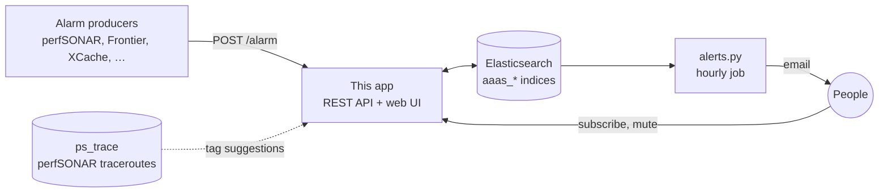

<div align="center">


# ATLAS Alarm & Alert Service · Frontend

The web app and REST API where ATLAS services post alarms and people subscribe to alerts about them.

[](https://github.com/ATLAS-Analytics/AlarmAlertServiceFrontend/actions/workflows/main.yaml)
[](Dockerfile)
[](LICENSE)

[**Open the service**](https://aaas.atlas-ml.org) · [Documentation](docs/documentation.md) · [Alert sender](https://github.com/ATLAS-Analytics/AlarmAndAlertService)

</div>

---

## What it does

- **Subscriptions.** Sign in with Globus and pick the alarm types you want emails about. Narrow each one down with tags: sites, hosts and networks (ASNs) are suggested from a month of perfSONAR traceroutes, and `*` patterns such as `*MWT2*` are allowed. Events that report a severity also let you pick levels.
- **Ongoing issues.** See what your subscriptions raised in the last 24 hours and mute a site's known problem for a while (a week by default).
- **Alarms and Heartbeats.** Browse them in embedded Kibana dashboards; alarms are filtered to your subscriptions.
- **REST API.** Alarm producers register alarm types and heartbeats, and post alarms.
- **Documentation.** The in-app [Documentation](https://aaas.atlas-ml.org/docs) page is rendered from [`docs/documentation.md`](docs/documentation.md).

## How it fits together



This app only stores alarms and subscriptions. The emails are sent by `alerts.py` in [AlarmAndAlertService](https://github.com/ATLAS-Analytics/AlarmAndAlertService), which runs every hour and matches new alarms against each user's subscriptions.

## Run it locally

You need Node.js 22.

```bash
npm install
npm run dev:mock    # sample data, no Elasticsearch needed
```

Open <http://localhost:8080>. The Globus login is stubbed, so you are signed in straight away.

| Command | Data | Writes |
| --- | --- | --- |
| `npm run dev:mock` | Built-in sample data ([`dev/mock-backends.js`](dev/mock-backends.js)) | Kept in memory; <http://localhost:8082> shows them |
| `npm run dev` | The real Elasticsearch, through a tunnel on `localhost:9200` ([`dev/real-backends.js`](dev/real-backends.js)) | Kept in memory: you sign in as `dev-user`, and nothing reaches Elasticsearch |

`npm run dev` reads these environment variables:

| Variable | Meaning |
| --- | --- |
| `ES_CREDS_FILE` | File with the Elasticsearch user and password on its first two lines |
| `ES_USER`, `ES_PASS` | The same, given directly |
| `ES_HOST` | Elasticsearch URL, `https://localhost:9200` by default |
| `AAAS_DEV_USER_ID` | Sign in as this real user instead of `dev-user` (read-only) |
| `AAAS_DEV_WRITE=1` | Together with `AAAS_DEV_USER_ID`: save that one user's changes to Elasticsearch |

```bash
ES_CREDS_FILE=~/path/to/creds.key npm run dev
```

A badge in the corner of every page shows which mode you are in.

## Configuration

In production the app reads two JSON files, mounted from Kubernetes secrets into `/etc/aaasf/`:

<details>
<summary><code>config.json</code></summary>

```json
{
  "ES_HOST": { "node": "https://…:9200", "auth": { "username": "…", "password": "…" } },
  "PREFERENCES": {
    "vacation": { "name": "Vacation mode", "type": "boolean", "default_value": false },
    "mail_interval": { "name": "Mail interval (hours)", "type": "number", "default_value": 6 },
    "prefered_mail": { "name": "Preferred email", "type": "email", "default_value": "" }
  },
  "TOPOLOGY_FIELDS": ["category", "subcategory", "event"],
  "REQUIRED_ALARM_FIELDS": ["body"],
  "OPTIONAL_ALARM_FIELDS": ["tags", "source", "level"],
  "REQUIRED_ALARM_TOPOLOGY_FIELDS": ["description", "template"],
  "REQUIRED_HEARTBEAT_FIELDS": [],
  "OPTIONAL_HEARTBEAT_FIELDS": ["source", "tags"],
  "REQUIRED_HEARTBEAT_TOPOLOGY_FIELDS": ["description", "template", "interval", "min_expected"]
}
```

`ES_HOST` is passed as-is to the Elasticsearch client.

</details>

<details>
<summary><code>globus-config.json</code></summary>

```json
{
  "CLIENT_ID": "…",
  "CLIENT_SECRET": "…",
  "REDIRECT_LINK": "https://aaas.atlas-ml.org/authcallback",
  "AUTHORIZE_URI": "https://auth.globus.org/v2/oauth2/authorize",
  "TOKEN_URI": "https://auth.globus.org/v2/oauth2/token",
  "LOGOUT_URI": "https://auth.globus.org/v2/web/logout"
}
```

</details>

## Deployment

1. Push to `main`.
2. [GitHub Actions](.github/workflows/main.yaml) builds the image `ivukotic/aaasf` and tags it `latest`, with the commit SHA, and with the short SHA.
3. The workflow notifies the GitOps repository `maniaclab/flux_apps`, which rolls the new image out to <https://aaas.atlas-ml.org>.

Pushes to `full_rewrite` and git tags build images tagged with the branch or tag name ([`dev.yaml`](.github/workflows/dev.yaml)). The Kubernetes manifest is in [`kube/frontend.yaml`](kube/frontend.yaml); its liveness probe calls `/healthz`.

## Elasticsearch

| Index | Holds |
| --- | --- |
| `aaas_categories` | Registered alarm types: category, subcategory, event, description, email template |
| `aaas_alarms` | Alarms: the type, `tags`, `body`, `source`, optional `level`, `created_at` |
| `aaas_heartbeats_topology` | Registered heartbeats, with their interval and expected count |
| `aaas_heartbeats` | Received heartbeats |
| `aaas_users` | Users: profile, `preferences`, `subscriptions`, `acknowledgements` (muted issues) |
| `ps_trace` | perfSONAR traceroutes, read for tag suggestions |
| `ps_asns_1` | Network names of ASNs, read for tag suggestions |

## REST API

Request bodies and examples are in the [documentation](docs/documentation.md#rest-api).

| Method | Path | Purpose |
| --- | --- | --- |
| `GET` | `/alarm/categories` | List registered alarm types |
| `GET` | `/alarm/tags` | Tag suggestions: sites, hosts, ASNs and each event's tags |
| `GET` | `/alarm/levels` | Severity levels seen per event |
| `POST` | `/alarm/category` | Register an alarm type |
| `PATCH` | `/alarm/category` | Edit an alarm type |
| `DELETE` | `/alarm/` | Unregister an alarm type |
| `POST` | `/alarm/` | Create an alarm |
| `POST` | `/alarm/fetch` | List recent alarms of a type |
| `GET` | `/user/` | List users |
| `GET` | `/user/:userId` | One user |
| `DELETE` | `/user/:userId` | Delete a user |
| `POST` | `/user/preferences/:userId` | Update preferences |
| `POST` | `/user/subscriptions/:userId` | Replace subscriptions |
| `POST` | `/user/acknowledgements/:userId` | Replace muted issues |
| `GET` | `/heartbeat/` | List registered heartbeats |
| `POST` | `/heartbeat/register` | Register a heartbeat |
| `PATCH` | `/heartbeat/` | Edit a heartbeat |
| `DELETE` | `/heartbeat/` | Unregister a heartbeat |
| `POST` | `/heartbeat/` | Send a heartbeat |
| `POST` | `/heartbeat/fetch` | List received heartbeats |

## Project layout

```text
server.js              Express app: login, pages, health check
routes/
  alarms.js            /alarm API, tag suggestions, severity levels, ongoing issues
  user.js              /user API: preferences, subscriptions, muted issues
  heartbeats.js        /heartbeat API and the missing-heartbeat checker
  docs.js              renders docs/documentation.md for the Documentation page
views/                 Pug templates
static/                CSS, browser JavaScript, images
docs/documentation.md  user and API documentation
dev/                   local development backends (npm run dev, npm run dev:mock)
kube/                  Kubernetes manifest
```

## License

[Apache 2.0](LICENSE)
